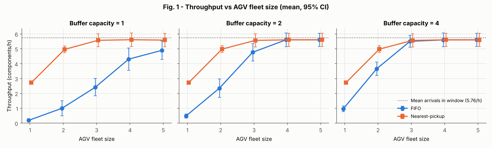
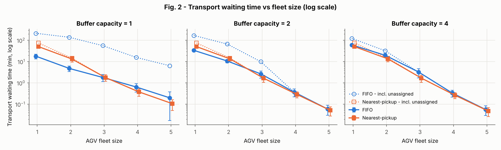
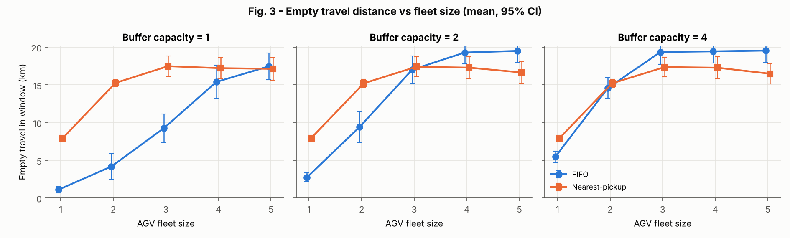
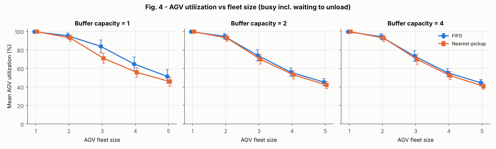
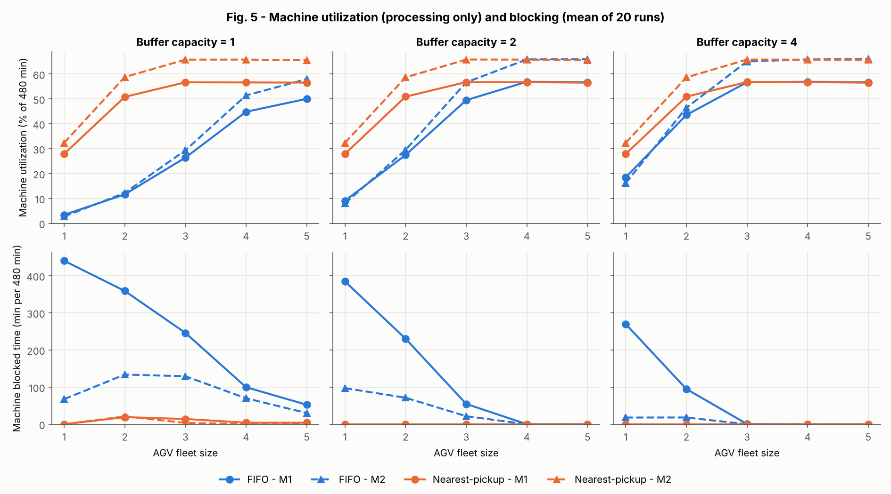
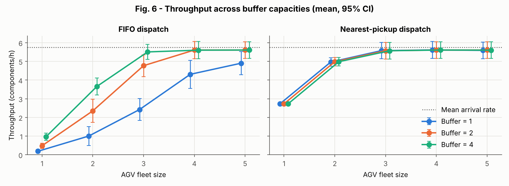
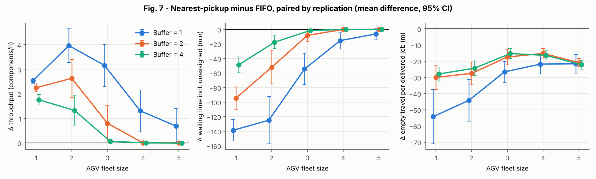
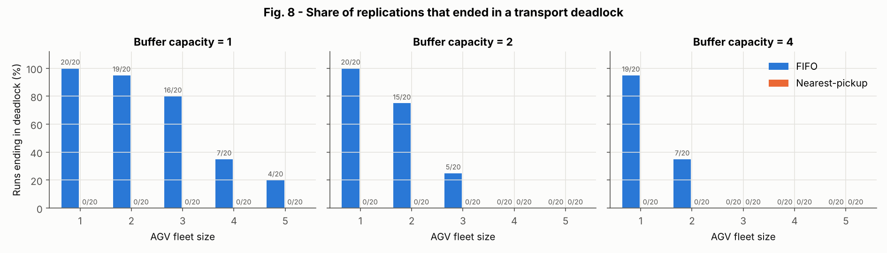

# Integrated AGV–Production-Line Simulation and Throughput Optimization

**Technical report** · Discrete-event simulation in Python/SimPy · Author: Anwesh

> All parameter values in this study (arrival rate, processing times, AGV speed, handling times, buffer sizes, layout) are **illustrative assumptions**. The model has **not** been calibrated against, or validated with, any real facility. Every number in the Results section was produced by `python main.py --run-all` and is read from the generated CSV files; the tables in Section 10 are inserted automatically.

---

## 1. Abstract

A two-machine flow line served by Automated Guided Vehicles (AGVs) was modelled as a discrete-event simulation. Components arrive at a raw-material store (exponential inter-arrival times, mean 10 min) and are carried by AGVs to Machine 1 (6 min), Machine 2 (7 min) and the finished-goods area along a 360 m straight route. Each machine has finite input and output buffers, machines block when their output buffer is full, and an AGV that arrives at a full input buffer waits, loaded, until space is free. A full factorial experiment (5 fleet sizes × 2 dispatch policies × 3 buffer capacities × 20 replications = 600 runs) was carried out with common random numbers.

With nearest-pickup dispatch, throughput rose from 2.73 components/h (1 AGV) to 4.96–4.98 (2 AGVs) and 5.57–5.58 (3 AGVs) and was flat afterwards; **three AGVs** reached 95% of the best observed throughput for every buffer size. With FIFO dispatch the same plant **deadlocked in 132 of 300 runs**: all AGVs ended up waiting, loaded, at a full input buffer of a machine that was itself blocked by a full output buffer. FIFO needed 3 AGVs with buffer capacity 4, 4 AGVs with capacity 2, and did not reach a plateau within 5 AGVs at capacity 1. Nearest-pickup never deadlocked in the 300 runs. The throughput plateau (≈5.61/h) is set by the arrival rate, not by machine capacity: at the plateau Machine 2, the most heavily loaded machine, was busy only about 66% of the time.

## 2. Engineering motivation

In a production line the machines are usually the expensive assets, but they can only work if material arrives on time and finished parts are taken away. AGVs decouple machines from manual handling, but an under-sized fleet starves machines, while an over-sized fleet wastes capital. Intermediate buffers absorb timing mismatches between transport and processing, yet they cost floor space and work-in-progress. The interaction of fleet size, dispatch rule and buffer size is hard to reason about analytically because of queueing, blocking and random arrivals — which is exactly what discrete-event simulation is designed to handle.

## 3. Objectives and research questions

1. How many AGVs are required to transport components without severely restricting production?
2. How does increasing the number of AGVs affect throughput?
3. How do buffer capacities influence production delays and machine blocking?
4. How do FIFO and nearest-pickup dispatch compare?
5. At what point does adding AGVs give diminishing returns, and what then limits the system?

## 4. Factory layout and model assumptions

| Location | Position (m) |
|---|---:|
| Raw material store | 0 |
| Machine 1 | 120 |
| Machine 2 | 240 |
| Finished goods area | 360 |

Route for every component: raw store → AGV → Machine 1 → AGV → Machine 2 → AGV → finished goods.

| Parameter | Value |
|---|---|
| AGV fleet sizes | 1, 2, 3, 4, 5 |
| AGV speed | 0.6 m/s = 36 m/min |
| Inter-arrival time | Exponential, mean 10 min |
| Machine 1 / Machine 2 processing | 6 min / 7 min (deterministic) |
| Pickup / drop-off handling | 0.25 min each |
| Run length / warm-up / measurement | 540 / 60 / 480 min |
| Buffer capacities tested | 1, 2, 4 (same for every input and output buffer) |
| Replications / base seed | 20 per configuration / 42 |

Assumptions:

- One-dimensional layout; distance = |x_destination − x_pickup|. AGVs travel in both directions, never collide, and need no route planning.
- AGVs carry one component, travel at constant speed (no acceleration), and start idle at the raw store at t = 0.
- The raw-material store and the finished-goods area have unlimited capacity.
- Processing times are deterministic; the arrival stream is the only random input.
- No batteries, charging, breakdowns, traffic control or operator effects (outside the agreed scope).
- The system starts empty; the first 60 minutes are excluded from all measurements.

## 5. Simulation methodology

The model is a **discrete-event simulation** written with **SimPy 4**. Time jumps from one event (an arrival, end of processing, end of travel …) to the next, so a 540-minute shift takes milliseconds to simulate. Each active element is a SimPy *process*:

| Process | Behaviour |
|---|---|
| Arrival generator | Creates components at pre-generated exponential arrival times and posts a transport job at the raw store. |
| Machine 1, Machine 2 | Take the oldest component from the input buffer, process it, reserve an output-buffer slot (blocking if none), place the part, post a transport job. |
| AGV 1…N | Wait for an assignment; travel empty; pick up; travel loaded; wait for destination space if needed; drop off; become idle again. |
| Dispatcher | Not a process but an event-driven function, called whenever a job is created or an AGV becomes idle. |

Code structure: `simulation.py` (model, metrics, invariant checks), `dispatch.py` (policies + dispatcher), `experiments.py` (design and batch runner), `analysis.py` (statistics, figures, tables), `main.py` (command line).

**Random numbers.** Arrival times for replication *r* are generated by a dedicated NumPy generator seeded with `SeedSequence([42, r])`. The seed does not depend on fleet size, buffer size or policy, so all 30 configurations see **identical arrivals** in replication *r* (common random numbers), while the 20 replications use different, independent streams.

**Verification during runs.** After *every* one of the 600 runs, `check_invariants()` checks route order, component conservation, buffer capacities, machine and AGV exclusivity, timestamp order and metric ranges; any violation stops the program. All 600 runs passed.

## 6. AGV dispatch logic

A **central dispatcher** keeps a list of idle AGVs and a list of unassigned transport jobs. Whenever either list changes it repeatedly selects one (AGV, job) pair with the active policy and **removes both from their lists before choosing the next pair**. This reservation step guarantees that a job or an AGV can never be assigned twice, even when several assignments happen at the same simulation time. There is no polling interval.

**Strategy A – FIFO.** Choose the job with the earliest creation time. Choose the AGV that has been idle the longest; AGV ID breaks ties.

**Strategy B – Nearest pickup.** Only the oldest waiting job at each pickup station is eligible. For every idle AGV and eligible job, empty distance = |x_AGV − x_pickup|; the pair with the smallest distance is chosen; ties are broken by job creation time, then AGV ID.

A job's waiting time runs from its creation (the moment the component is available at the pickup station) to its assignment.

## 7. Machine and buffer modelling

Each machine has an **input buffer** and an **output buffer**, both with the tested capacity *B*. A buffer is modelled as *B* slots:

- To place a component, a slot must first be **reserved**; if all slots are taken, the requester waits.
- The slot is released when the component is removed.

Rules that follow from this:

| Rule | Implementation |
|---|---|
| Input capacity counts only waiting parts | The machine removes the part from the input buffer (freeing the slot) when processing starts. |
| One part at a time per machine | A single machine process; processing intervals checked for overlap. |
| Blocking after service | After processing, the machine requests an output slot. If none is free it enters state *blocked* and keeps the finished part; it cannot start another part. |
| AGV waits to unload | On arrival at a machine the AGV requests an input slot. If none is free it waits in state *waiting for buffer space* and remains unavailable. |
| Drop-off | The slot is reserved before the 0.25-min drop-off; the part enters the buffer at the end of drop-off. |
| Pickup | The part leaves the buffer (freeing its slot) at the end of the 0.25-min pickup. |

**Deadlock.** These rules — which follow the project specification — make a circular wait possible. If every AGV is waiting, loaded, at a full input buffer, and every machine they wait at is blocked by a full output buffer, no AGV is free to empty those output buffers and nothing can ever move again. The model does not prevent this; it **detects** it. The deadlock condition is evaluated whenever an AGV starts or stops waiting or a machine becomes blocked or unblocked, and the run is marked *deadlocked* if the condition still holds at the end. A test confirms that a reported deadlock is genuine.

## 8. Experimental design

| Factor | Levels |
|---|---|
| Fleet size | 1, 2, 3, 4, 5 AGVs |
| Dispatch policy | FIFO, nearest pickup |
| Buffer capacity | 1, 2, 4 |
| Replications | 20 (seeds `SeedSequence([42, r])`, r = 0…19) |

Total: 5 × 2 × 3 × 20 = **600 runs**, taking about 3 s on one CPU core. A 24-run quick design (`python main.py --quick`) checks the whole pipeline.

## 9. Governing equations and performance metrics

Measurement window: W = [60, 540) min, length T = 480 min = 8 h.

| Quantity | Equation / definition |
|---|---|
| Speed conversion | v = 0.6 m/s × 60 = 36 m/min |
| Travel time | t = d / v; d = 120 m → t = 3.33 min (200 s) |
| One loaded leg | 0.25 + 3.33 + 0.25 = 3.83 min |
| Window overlap of an interval [a, b] | ov = max(0, min(b, 540) − max(a, 60)) |
| A. Throughput | TH = (components delivered to finished goods during W) / 8 h |
| B. Transport waiting time | mean of (t_assigned − t_created) over jobs created in W and assigned before the end. Jobs never assigned are counted separately (backlog) and in a lower-bound version where their wait is taken as 540 − t_created. |
| C. Empty travel | Σ d_empty × ov / (segment duration) — the distance is pro-rated by the fraction of the segment inside W (constant speed). |
| D. AGV utilization | U_k = Σ ov(busy intervals of AGV k) / 480 × 100%. Busy = from assignment to end of drop-off, including empty travel, loaded travel, handling and waiting for buffer space. Fleet utilization = mean of U_k. |
| E. Machine utilization | Σ ov(processing intervals) / 480 × 100%. Blocked time is **not** counted. |
| F. Machine blocking | Σ ov(blocked intervals), minutes per 480-min window. A blocked interval starts when processing ends and no output slot is free, and ends when a slot becomes free (an AGV removes a part). |
| 95% confidence interval | x̄ ± t(0.975, n−1) · s / √n, with t(0.975, 19) = 2.093 |
| Paired comparison | d_r = X_r(nearest) − X_r(FIFO) for the same replication r; CI of mean(d) by the same t-formula |
| Fleet-sizing rule | N* = min{N : TH̄(N) ≥ 0.95 · max_N TH̄(N)} over tested N |

Quick capacity estimates (Table R1): arrivals 6.0/h; Machine 1 capacity 10/h; Machine 2 capacity 8.57/h; expected utilizations at full flow 60% and 70%; loaded AGV work alone requires 6 × 11.5 / 60 = 1.15 AGVs before any empty travel. One AGV can therefore never keep up, which the results confirm.

## 10. Results

All figures are in `results/figures/`, all CSV files in `results/`. Confidence intervals describe variability **between replications of this model**; they say nothing about how accurately the model represents a real factory.

**Realised demand.** Over the 20 arrival streams the mean number of arrivals in the window corresponds to 5.76 components/h (range 4.0–7.6/h), slightly below the theoretical 6.0/h. This is the practical ceiling on throughput (dotted line in Figs 1 and 6).

### 10.1 Throughput and fleet size (RQ 1, 2, 5)

- **Nearest pickup:** 2.73/h with one AGV, 4.96–4.98/h with two, 5.57–5.58/h with three, and 5.59–5.61/h with four or five. Adding a fourth AGV changed mean throughput by only +0.04/h; the fifth by −0.02 to +0.00/h (Table R4).
- **FIFO:** much lower at small fleets and strongly dependent on buffer size; with buffer capacity 4 it reaches 5.51/h at 3 AGVs, with capacity 2 it needs 4 AGVs (5.61/h), and with capacity 1 it is still rising at 5 AGVs (4.90/h, +0.59/h from the fifth AGV).
- **Fleet sizing (Table R3):** the smallest fleet reaching 95% of the best observed mean throughput is **3 AGVs for nearest pickup at every buffer size**; for FIFO it is 3 (B = 4), 4 (B = 2) and 5 (B = 1). For FIFO with B = 1 the fifth AGV still added 13.8%, so **the tested range is insufficient to show saturation** in that case; the "5" is only the best of the tested sizes. In all other cases throughput changed by less than ±0.5% between 4 and 5 AGVs, i.e. a plateau was observed.
- The 95% threshold is relative to the best result **in this experiment**, not to a theoretical maximum.

### 10.2 Waiting time, empty travel and AGV utilization

Waiting time falls by roughly an order of magnitude per added AGV once the fleet is large enough (Fig. 2, log scale). For overloaded or deadlocked configurations the "assigned jobs only" average is misleadingly small because the longest-waiting jobs were never assigned; the lower bound (dotted lines, Table R2b) is then the fairer measure — e.g. FIFO, B = 1, 1 AGV: 18.0 min for assigned jobs, but at least 213.7 min when unassigned jobs are included.

Total empty distance (Fig. 3) grows with fleet size at first simply because more work is done. Per delivered transport job, nearest pickup drove **15–54 m less empty distance than FIFO in every one of the 15 buffer/fleet combinations**, all statistically significant (Table R5, last column).

Fleet utilization falls from 99.7% (1 AGV) to about 41–51% (5 AGVs). Because the specification counts waiting to unload as busy time, deadlocked FIFO runs show high utilization although the vehicles are not moving; Table R2b reports this wait time separately. Table R7 shows that FIFO spreads work evenly over the vehicles (it assigns the longest-idle AGV), whereas nearest pickup does not: with 5 AGVs and B = 4, AGV 1 was busy 55.5% and AGV 5 only 24.0%, because ties in distance are broken by AGV ID.

### 10.3 Machine utilization and blocking (RQ 3, 5)

At the throughput plateau Machine 1 was processing about 57% and Machine 2 about 66% of the time. This agrees with a flow-balance check: utilization ≈ throughput × processing time (5.61/h × 7 min / 60 ≈ 65%). **Neither machine is saturated.** Machine 2 is the most heavily loaded machine and would become the bottleneck if demand rose above 8.57/h, but under the assumed demand the line is **arrival-limited**.

Machine blocking is large under FIFO with small buffers and few AGVs (e.g. Machine 1 blocked 440 of 480 min with 1 AGV and B = 1), because FIFO keeps sending AGVs to old raw-store jobs instead of clearing machine output buffers. Under nearest pickup, blocking never exceeded about 21 min per shift and was zero with B ≥ 2.

### 10.4 Buffer capacity (RQ 3)

Table R6 compares B = 4 with B = 1 on the same arrival streams.

- **FIFO:** larger buffers increased throughput significantly for 1–4 AGVs (by 0.78 to 3.09 components/h) and reduced blocking and deadlocks; at 5 AGVs the difference (+0.71/h) was not significant at the 95% level.
- **Nearest pickup:** no significant throughput difference at any fleet size (all |Δ| ≤ 0.02/h). Larger buffers did remove the small amount of blocking (e.g. 19 and 21 min at 2 AGVs), but because the machines are not the constraint, this idle machine time did not translate into output. With one AGV the buffers never become a constraint (no blocking and no waiting to unload), so all three buffer sizes give identical results.

### 10.5 FIFO versus nearest pickup (RQ 4)

- Nearest pickup gave **significantly higher throughput** in 9 of the 15 buffer/fleet combinations (by 0.80 to 3.96 components/h) and was never significantly worse. Where the fleet is large enough (≥ 4 AGVs with B ≥ 2, ≥ 3 AGVs with B = 4) the two policies produced practically the same throughput.
- **Deadlocks** occurred only under FIFO: 132 of 300 FIFO runs versus 0 of 300 nearest-pickup runs (Fig. 8). The earliest deadlock started 60.4 min into a run.
- Why nearest pickup avoids the deadlock in these runs: a machine can only be blocked when its output buffer is full, and an AGV that has just delivered to that machine is at distance 0 from that output buffer, so it is sent to clear it. FIFO instead follows job age and repeatedly sends every free AGV to the long queue of raw-store jobs. This is an observation from 300 runs, not a proof that nearest pickup can never deadlock.

### 10.6 Numerical tables

<!-- BEGIN AUTO-GENERATED TABLES (do not edit by hand; regenerated by main.py) -->

#### Table R1 - Hand-calculation checks

| Quantity | Value |
|---|---:|
| AGV speed (m/min) | 36.000 |
| Travel time for 120 m (min) | 3.333 |
| One loaded leg incl. handling (min) | 3.833 |
| Loaded AGV time per component, 3 legs (min) | 11.500 |
| Mean arrival rate (components/h) | 6.000 |
| Machine 1 capacity (components/h) | 10.000 |
| Machine 2 capacity (components/h) | 8.571 |
| Expected M1 utilization at full flow (%) | 60.000 |
| Expected M2 utilization at full flow (%) | 70.000 |
| Min. AGV-hours per hour for loaded work only (AGVs) | 1.150 |

#### Table R2 - Results per configuration (mean over replications; throughput with 95% CI)

| Policy | Buffer | AGVs | Throughput /h [95% CI] | Std | Wait (min) | Unassigned jobs at end | Empty km | AGV util % | M1 util % | M2 util % | M1 blocked min | M2 blocked min | Deadlock runs |
|---|---:|---:|---|---:|---:|---:|---:|---:|---:|---:|---:|---:|---:|
| FIFO | 1 | 1 | 0.19 [0.09, 0.28] | 0.20 | 17.99 | 45.0 | 1.11 | 99.7 | 3.4 | 2.8 | 440.3 | 67.7 | 20/20 |
| FIFO | 1 | 2 | 1.00 [0.49, 1.51] | 1.08 | 4.79 | 36.6 | 4.16 | 95.3 | 11.6 | 12.2 | 359.0 | 133.8 | 19/20 |
| FIFO | 1 | 3 | 2.42 [1.83, 3.01] | 1.26 | 1.81 | 24.1 | 9.24 | 83.8 | 26.4 | 29.4 | 246.1 | 129.2 | 16/20 |
| FIFO | 1 | 4 | 4.31 [3.56, 5.06] | 1.60 | 0.64 | 9.3 | 15.39 | 64.8 | 44.8 | 51.4 | 99.8 | 70.0 | 7/20 |
| FIFO | 1 | 5 | 4.90 [4.28, 5.52] | 1.32 | 0.20 | 5.1 | 17.45 | 51.4 | 50.1 | 58.0 | 52.5 | 30.2 | 4/20 |
| FIFO | 2 | 1 | 0.48 [0.34, 0.62] | 0.30 | 33.84 | 41.5 | 2.74 | 99.7 | 9.1 | 8.0 | 384.7 | 97.2 | 20/20 |
| FIFO | 2 | 2 | 2.35 [1.73, 2.97] | 1.32 | 10.68 | 25.2 | 9.42 | 94.7 | 27.5 | 29.5 | 230.3 | 71.3 | 15/20 |
| FIFO | 2 | 3 | 4.77 [4.18, 5.35] | 1.25 | 2.67 | 6.5 | 17.00 | 74.1 | 49.5 | 56.7 | 54.7 | 21.6 | 5/20 |
| FIFO | 2 | 4 | 5.61 [5.15, 6.07] | 0.98 | 0.37 | 0.0 | 19.29 | 56.0 | 56.9 | 65.9 | 0.1 | 0.0 | 0/20 |
| FIFO | 2 | 5 | 5.61 [5.16, 6.05] | 0.95 | 0.06 | 0.0 | 19.50 | 45.2 | 56.8 | 66.0 | 0.0 | 0.0 | 0/20 |
| FIFO | 4 | 1 | 0.97 [0.77, 1.16] | 0.42 | 60.96 | 36.0 | 5.47 | 99.7 | 18.5 | 16.2 | 269.7 | 18.0 | 19/20 |
| FIFO | 4 | 2 | 3.66 [3.19, 4.12] | 0.99 | 19.79 | 14.7 | 14.59 | 94.3 | 43.6 | 46.5 | 94.8 | 18.1 | 7/20 |
| FIFO | 4 | 3 | 5.51 [5.11, 5.90] | 0.84 | 3.23 | 1.1 | 19.36 | 73.4 | 56.7 | 65.1 | 0.6 | 0.0 | 0/20 |
| FIFO | 4 | 4 | 5.60 [5.14, 6.06] | 0.98 | 0.34 | 0.1 | 19.44 | 55.5 | 56.9 | 65.9 | 0.0 | 0.0 | 0/20 |
| FIFO | 4 | 5 | 5.61 [5.16, 6.05] | 0.95 | 0.06 | 0.0 | 19.55 | 44.5 | 56.8 | 66.1 | 0.0 | 0.0 | 0/20 |
| Nearest-pickup | 1 | 1 | 2.73 [2.68, 2.77] | 0.09 | 50.56 | 26.2 | 7.95 | 99.7 | 27.9 | 32.4 | 0.0 | 0.0 | 0/20 |
| Nearest-pickup | 1 | 2 | 4.96 [4.73, 5.19] | 0.49 | 13.22 | 5.7 | 15.25 | 92.9 | 50.8 | 58.8 | 19.1 | 21.0 | 0/20 |
| Nearest-pickup | 1 | 3 | 5.58 [5.14, 6.01] | 0.93 | 1.79 | 0.5 | 17.47 | 71.1 | 56.7 | 65.8 | 14.1 | 3.5 | 0/20 |
| Nearest-pickup | 1 | 4 | 5.61 [5.16, 6.07] | 0.97 | 0.38 | 0.0 | 17.21 | 55.7 | 56.6 | 65.8 | 4.2 | 0.4 | 0/20 |
| Nearest-pickup | 1 | 5 | 5.59 [5.14, 6.04] | 0.96 | 0.11 | 0.0 | 17.12 | 45.8 | 56.6 | 65.6 | 4.1 | 0.0 | 0/20 |
| Nearest-pickup | 2 | 1 | 2.73 [2.68, 2.77] | 0.09 | 50.56 | 26.2 | 7.95 | 99.7 | 27.9 | 32.4 | 0.0 | 0.0 | 0/20 |
| Nearest-pickup | 2 | 2 | 4.98 [4.75, 5.21] | 0.49 | 13.50 | 5.8 | 15.20 | 92.8 | 50.9 | 58.7 | 0.0 | 0.0 | 0/20 |
| Nearest-pickup | 2 | 3 | 5.57 [5.12, 6.02] | 0.95 | 1.69 | 0.2 | 17.39 | 70.0 | 56.8 | 65.9 | 0.0 | 0.0 | 0/20 |
| Nearest-pickup | 2 | 4 | 5.61 [5.16, 6.05] | 0.96 | 0.29 | 0.1 | 17.28 | 53.1 | 56.8 | 65.8 | 0.0 | 0.0 | 0/20 |
| Nearest-pickup | 2 | 5 | 5.61 [5.16, 6.06] | 0.96 | 0.05 | 0.0 | 16.64 | 42.1 | 56.5 | 65.6 | 0.0 | 0.0 | 0/20 |
| Nearest-pickup | 4 | 1 | 2.73 [2.68, 2.77] | 0.09 | 50.56 | 26.2 | 7.95 | 99.7 | 27.9 | 32.4 | 0.0 | 0.0 | 0/20 |
| Nearest-pickup | 4 | 2 | 4.98 [4.75, 5.21] | 0.49 | 13.50 | 5.8 | 15.20 | 92.8 | 50.9 | 58.7 | 0.0 | 0.0 | 0/20 |
| Nearest-pickup | 4 | 3 | 5.57 [5.12, 6.02] | 0.95 | 1.69 | 0.2 | 17.36 | 69.8 | 56.8 | 65.8 | 0.0 | 0.0 | 0/20 |
| Nearest-pickup | 4 | 4 | 5.61 [5.16, 6.05] | 0.96 | 0.27 | 0.1 | 17.27 | 52.3 | 56.8 | 65.8 | 0.0 | 0.0 | 0/20 |
| Nearest-pickup | 4 | 5 | 5.60 [5.16, 6.04] | 0.95 | 0.05 | 0.0 | 16.48 | 40.9 | 56.6 | 65.7 | 0.0 | 0.0 | 0/20 |

#### Table R2b - Diagnostics that explain Table R2

Waiting time in R2 averages only jobs that were eventually assigned. When a run deadlocks or the fleet is overloaded, many jobs are never assigned, so the lower bound below (unassigned jobs counted with their wait up to the end of the run) is the fairer comparison. AGV utilization counts time spent waiting to unload as busy time, as specified.

| Policy | Buffer | AGVs | Wait, assigned jobs (min) | Wait lower bound incl. unassigned (min) | Transport jobs delivered | Empty m per delivered job | AGV wait-to-unload (min, fleet total) | Deadlock runs | Mean deadlock onset (min) |
|---|---:|---:|---:|---:|---:|---:|---:|---:|---:|
| FIFO | 1 | 1 | 17.99 | 213.73 | 6.7 | 174.2 | 419.3 | 20/20 | 121 |
| FIFO | 1 | 2 | 4.79 | 139.22 | 26.1 | 170.7 | 693.7 | 19/20 | 179 |
| FIFO | 1 | 3 | 1.81 | 56.23 | 61.1 | 155.8 | 708.4 | 16/20 | 262 |
| FIFO | 1 | 4 | 0.64 | 15.79 | 105.8 | 148.5 | 403.5 | 7/20 | 303 |
| FIFO | 1 | 5 | 0.20 | 6.44 | 119.5 | 147.9 | 284.8 | 4/20 | 329 |
| FIFO | 2 | 1 | 33.84 | 169.54 | 18.2 | 149.9 | 329.5 | 20/20 | 211 |
| FIFO | 2 | 2 | 10.68 | 66.67 | 62.1 | 153.5 | 403.1 | 15/20 | 277 |
| FIFO | 2 | 3 | 2.67 | 9.97 | 117.2 | 145.9 | 141.3 | 5/20 | 370 |
| FIFO | 2 | 4 | 0.37 | 0.37 | 135.8 | 142.2 | 13.1 | 0/20 | – |
| FIFO | 2 | 5 | 0.06 | 0.06 | 135.9 | 143.3 | 15.6 | 0/20 | – |
| FIFO | 4 | 1 | 60.96 | 123.76 | 37.1 | 147.8 | 181.4 | 19/20 | 349 |
| FIFO | 4 | 2 | 19.79 | 32.29 | 97.4 | 150.4 | 122.0 | 7/20 | 375 |
| FIFO | 4 | 3 | 3.23 | 3.22 | 134.4 | 143.5 | 0.0 | 0/20 | – |
| FIFO | 4 | 4 | 0.34 | 0.34 | 135.7 | 143.4 | 0.0 | 0/20 | – |
| FIFO | 4 | 5 | 0.06 | 0.06 | 135.9 | 143.7 | 0.0 | 0/20 | – |
| Nearest-pickup | 1 | 1 | 50.56 | 75.10 | 66.2 | 120.0 | 0.0 | 0/20 | – |
| Nearest-pickup | 1 | 2 | 13.22 | 14.38 | 121.0 | 126.5 | 0.6 | 0/20 | – |
| Nearest-pickup | 1 | 3 | 1.79 | 1.79 | 135.3 | 129.2 | 15.1 | 0/20 | – |
| Nearest-pickup | 1 | 4 | 0.38 | 0.38 | 135.8 | 126.7 | 66.8 | 0/20 | – |
| Nearest-pickup | 1 | 5 | 0.11 | 0.11 | 135.3 | 126.3 | 100.9 | 0/20 | – |
| Nearest-pickup | 2 | 1 | 50.56 | 75.10 | 66.2 | 120.0 | 0.0 | 0/20 | – |
| Nearest-pickup | 2 | 2 | 13.50 | 14.64 | 121.1 | 126.0 | 0.0 | 0/20 | – |
| Nearest-pickup | 2 | 3 | 1.69 | 1.69 | 135.6 | 128.4 | 1.2 | 0/20 | – |
| Nearest-pickup | 2 | 4 | 0.29 | 0.29 | 135.9 | 127.0 | 16.2 | 0/20 | – |
| Nearest-pickup | 2 | 5 | 0.05 | 0.05 | 135.6 | 122.5 | 25.2 | 0/20 | – |
| Nearest-pickup | 4 | 1 | 50.56 | 75.10 | 66.2 | 120.0 | 0.0 | 0/20 | – |
| Nearest-pickup | 4 | 2 | 13.50 | 14.64 | 121.1 | 126.0 | 0.0 | 0/20 | – |
| Nearest-pickup | 4 | 3 | 1.69 | 1.69 | 135.6 | 128.2 | 0.0 | 0/20 | – |
| Nearest-pickup | 4 | 4 | 0.27 | 0.27 | 135.8 | 127.0 | 0.0 | 0/20 | – |
| Nearest-pickup | 4 | 5 | 0.05 | 0.05 | 135.4 | 121.6 | 0.0 | 0/20 | – |

#### Table R3 - Fleet sizing (smallest tested fleet reaching 95% of the best observed mean throughput)

| Policy | Buffer | Best mean /h (at N) | 95% threshold /h | Min. fleet | Throughput at min. fleet [95% CI] | Wait (min) | AGV util % | Deadlock % | Gain between two largest fleets | Plateau shown? |
|---|---:|---|---:|---:|---|---:|---:|---:|---:|---|
| FIFO | 1 | 4.90 (5) | 4.66 | 5 | 4.90 [4.28, 5.52] | 0.20 | 51.4 | 20 | 13.8% | NO - range insufficient |
| FIFO | 2 | 5.61 (4) | 5.33 | 4 | 5.61 [5.15, 6.07] | 0.37 | 56.0 | 0 | 0.0% | yes |
| FIFO | 4 | 5.61 (5) | 5.33 | 3 | 5.51 [5.11, 5.90] | 3.23 | 73.4 | 0 | 0.1% | yes |
| Nearest-pickup | 1 | 5.61 (4) | 5.33 | 3 | 5.58 [5.14, 6.01] | 1.79 | 71.1 | 0 | -0.4% | yes |
| Nearest-pickup | 2 | 5.61 (4) | 5.33 | 3 | 5.57 [5.12, 6.02] | 1.69 | 70.0 | 0 | 0.0% | yes |
| Nearest-pickup | 4 | 5.61 (4) | 5.33 | 3 | 5.57 [5.12, 6.02] | 1.69 | 69.8 | 0 | -0.1% | yes |

#### Table R4 - Marginal throughput gain from adding one AGV (components/h)

| Policy | Buffer | 1→2 | 2→3 | 3→4 | 4→5 |
|---|---:|---:|---:|---:|---:|
| FIFO | 1 | +0.81 | +1.42 | +1.89 | +0.59 |
| FIFO | 2 | +1.87 | +2.42 | +0.84 | +0.00 |
| FIFO | 4 | +2.69 | +1.85 | +0.09 | +0.01 |
| Nearest-pickup | 1 | +2.24 | +0.61 | +0.04 | -0.02 |
| Nearest-pickup | 2 | +2.26 | +0.59 | +0.04 | +0.00 |
| Nearest-pickup | 4 | +2.26 | +0.59 | +0.04 | -0.01 |

#### Table R5 - Paired comparison: nearest-pickup minus FIFO (same arrival streams)

| Buffer | AGVs | Δ throughput /h [95% CI] | Verdict | Δ wait, assigned jobs (min) | Δ wait lower bound (min) [95% CI] | Δ empty km total [95% CI] | Δ empty m per delivered job [95% CI] |
|---:|---:|---|---|---:|---|---|---|
| 1 | 1 | 2.54 [2.43, 2.65] | nearest higher | 29.67 | -138.63 [-153.38, -123.89] | 6.84 [6.43, 7.25] | -54.3 [-71.1, -37.4] |
| 1 | 2 | 3.96 [3.28, 4.65] | nearest higher | 7.92 | -124.84 [-157.39, -92.29] | 11.08 [9.05, 13.12] | -44.2 [-57.1, -31.4] |
| 1 | 3 | 3.16 [2.30, 4.02] | nearest higher | -0.01 | -54.43 [-75.90, -32.96] | 8.23 [5.53, 10.93] | -26.6 [-33.0, -20.2] |
| 1 | 4 | 1.31 [0.45, 2.16] | nearest higher | -0.26 | -15.41 [-26.88, -3.93] | 1.83 [-0.60, 4.25] | -21.8 [-27.9, -15.8] |
| 1 | 5 | 0.69 [-0.03, 1.41] | no significant difference | -0.09 | -6.34 [-13.46, 0.79] | -0.33 [-2.38, 1.71] | -21.6 [-27.4, -15.8] |
| 2 | 1 | 2.24 [2.09, 2.40] | nearest higher | 16.72 | -94.44 [-109.94, -78.94] | 5.21 [4.63, 5.79] | -30.0 [-37.4, -22.6] |
| 2 | 2 | 2.63 [1.86, 3.41] | nearest higher | 2.82 | -52.03 [-74.71, -29.34] | 5.78 [3.56, 8.01] | -27.5 [-34.5, -20.6] |
| 2 | 3 | 0.80 [0.07, 1.53] | nearest higher | -0.98 | -8.28 [-16.25, -0.31] | 0.39 [-1.64, 2.43] | -17.4 [-22.2, -12.6] |
| 2 | 4 | 0.00 [-0.03, 0.03] | no significant difference | -0.08 | -0.08 [-0.17, 0.00] | -2.00 [-2.36, -1.65] | -15.2 [-18.1, -12.3] |
| 2 | 5 | 0.00 [-0.03, 0.03] | no significant difference | -0.01 | -0.01 [-0.02, 0.01] | -2.86 [-3.17, -2.54] | -20.9 [-23.5, -18.3] |
| 4 | 1 | 1.76 [1.54, 1.97] | nearest higher | -10.40 | -48.66 [-59.54, -37.79] | 2.48 [1.72, 3.24] | -27.9 [-32.2, -23.5] |
| 4 | 2 | 1.32 [0.72, 1.93] | nearest higher | -6.28 | -17.65 [-26.42, -8.87] | 0.61 [-0.83, 2.06] | -24.4 [-28.9, -19.8] |
| 4 | 3 | 0.06 [-0.04, 0.16] | no significant difference | -1.54 | -1.53 [-2.42, -0.64] | -2.00 [-2.45, -1.55] | -15.3 [-18.3, -12.3] |
| 4 | 4 | 0.01 [-0.03, 0.04] | no significant difference | -0.07 | -0.07 [-0.12, -0.02] | -2.17 [-2.52, -1.82] | -16.4 [-19.3, -13.6] |
| 4 | 5 | -0.01 [-0.04, 0.02] | no significant difference | -0.01 | -0.01 [-0.02, 0.01] | -3.07 [-3.44, -2.69] | -22.2 [-24.8, -19.5] |

#### Table R7 - Utilization of each AGV (% of the 480-min window, mean over replications)

| Policy | Buffer | AGVs | AGV 1 | AGV 2 | AGV 3 | AGV 4 | AGV 5 | Fleet mean |
|---|---:|---:|---:|---:|---:|---:|---:|---:|
| FIFO | 1 | 1 | 99.7 | – | – | – | – | 99.7 |
| FIFO | 1 | 2 | 95.4 | 95.3 | – | – | – | 95.3 |
| FIFO | 1 | 3 | 83.4 | 84.1 | 83.9 | – | – | 83.8 |
| FIFO | 1 | 4 | 64.4 | 64.9 | 65.2 | 64.7 | – | 64.8 |
| FIFO | 1 | 5 | 51.0 | 51.6 | 51.3 | 51.2 | 52.0 | 51.4 |
| FIFO | 2 | 1 | 99.7 | – | – | – | – | 99.7 |
| FIFO | 2 | 2 | 94.5 | 94.8 | – | – | – | 94.7 |
| FIFO | 2 | 3 | 74.2 | 73.9 | 74.2 | – | – | 74.1 |
| FIFO | 2 | 4 | 55.7 | 56.6 | 55.6 | 55.8 | – | 56.0 |
| FIFO | 2 | 5 | 45.7 | 44.7 | 44.6 | 45.7 | 45.1 | 45.2 |
| FIFO | 4 | 1 | 99.7 | – | – | – | – | 99.7 |
| FIFO | 4 | 2 | 94.3 | 94.4 | – | – | – | 94.3 |
| FIFO | 4 | 3 | 73.4 | 72.9 | 73.9 | – | – | 73.4 |
| FIFO | 4 | 4 | 55.4 | 55.6 | 55.2 | 55.8 | – | 55.5 |
| FIFO | 4 | 5 | 45.0 | 44.3 | 43.8 | 44.9 | 44.6 | 44.5 |
| Nearest-pickup | 1 | 1 | 99.7 | – | – | – | – | 99.7 |
| Nearest-pickup | 1 | 2 | 93.7 | 92.1 | – | – | – | 92.9 |
| Nearest-pickup | 1 | 3 | 74.7 | 71.4 | 67.1 | – | – | 71.1 |
| Nearest-pickup | 1 | 4 | 64.5 | 59.4 | 54.4 | 44.4 | – | 55.7 |
| Nearest-pickup | 1 | 5 | 60.7 | 52.6 | 45.9 | 39.2 | 30.7 | 45.8 |
| Nearest-pickup | 2 | 1 | 99.7 | – | – | – | – | 99.7 |
| Nearest-pickup | 2 | 2 | 93.6 | 92.0 | – | – | – | 92.8 |
| Nearest-pickup | 2 | 3 | 73.9 | 70.4 | 65.5 | – | – | 70.0 |
| Nearest-pickup | 2 | 4 | 62.9 | 57.5 | 51.9 | 40.4 | – | 53.1 |
| Nearest-pickup | 2 | 5 | 56.8 | 51.6 | 41.8 | 33.7 | 26.6 | 42.1 |
| Nearest-pickup | 4 | 1 | 99.7 | – | – | – | – | 99.7 |
| Nearest-pickup | 4 | 2 | 93.6 | 92.0 | – | – | – | 92.8 |
| Nearest-pickup | 4 | 3 | 73.5 | 69.9 | 66.0 | – | – | 69.8 |
| Nearest-pickup | 4 | 4 | 62.3 | 56.5 | 50.4 | 39.8 | – | 52.3 |
| Nearest-pickup | 4 | 5 | 55.5 | 50.3 | 41.4 | 33.0 | 24.0 | 40.9 |

#### Table R6 - Paired effect of buffer capacity 4 vs 1 (buffer 4 minus buffer 1)

| Policy | AGVs | Δ throughput /h [95% CI] | Verdict | Δ M1 blocked min [95% CI] | Δ M2 blocked min [95% CI] |
|---|---:|---|---|---|---|
| FIFO | 1 | 0.78 [0.60, 0.96] | buffer 4 higher | -170.5 [-203.4, -137.6] | -49.7 [-127.2, 27.7] |
| FIFO | 2 | 2.66 [2.04, 3.27] | buffer 4 higher | -264.2 [-323.6, -204.9] | -115.7 [-200.9, -30.4] |
| FIFO | 3 | 3.09 [2.27, 3.90] | buffer 4 higher | -245.5 [-308.1, -182.9] | -129.2 [-201.5, -56.9] |
| FIFO | 4 | 1.29 [0.45, 2.14] | buffer 4 higher | -99.8 [-159.7, -39.8] | -70.0 [-127.9, -12.1] |
| FIFO | 5 | 0.71 [-0.01, 1.42] | no significant difference | -52.5 [-99.0, -5.9] | -30.2 [-65.4, 5.0] |
| Nearest-pickup | 1 | 0.00 [0.00, 0.00] | no significant difference | 0.0 [0.0, 0.0] | 0.0 [0.0, 0.0] |
| Nearest-pickup | 2 | 0.02 [-0.02, 0.06] | no significant difference | -19.1 [-22.3, -15.9] | -21.0 [-26.7, -15.4] |
| Nearest-pickup | 3 | -0.01 [-0.03, 0.02] | no significant difference | -14.1 [-20.0, -8.1] | -3.5 [-5.3, -1.8] |
| Nearest-pickup | 4 | -0.01 [-0.03, 0.02] | no significant difference | -4.2 [-5.6, -2.8] | -0.4 [-0.8, 0.1] |
| Nearest-pickup | 5 | 0.01 [-0.01, 0.03] | no significant difference | -4.1 [-5.3, -2.8] | -0.0 [-0.0, 0.0] |

<!-- END AUTO-GENERATED TABLES -->

## 11. Discussion of bottlenecks and fleet sizing

**Where is the bottleneck?** It moves with the fleet size. With one or two AGVs the **transport system** is the bottleneck: AGVs are more than 92% utilized, a backlog of unassigned jobs grows at the raw store, and machines starve (nearest pickup, 1 AGV: M2 busy only 32%). From three AGVs (nearest pickup) the **arrival stream** is the constraint: throughput tracks arrivals, AGV utilization falls to about 70%, and machines are busy 57% and 66% — they are waiting for work, not overwhelmed by it. Machine 2 is the highest-utilized resource and would be the next bottleneck if demand grew, but within these assumptions processing capacity never limits output.

**Diminishing returns (RQ 5).** For nearest pickup the marginal gain was +2.24 to +2.26/h for the second AGV, +0.59 to +0.61/h for the third, and at most +0.04/h after that. The diminishing returns come from **demand saturation**, not from machine saturation. Testing whether machine processing becomes limiting would require higher arrival rates (see Extensions).

**Recommended fleet.** Under these assumptions: **3 AGVs with nearest-pickup dispatch**, at any of the tested buffer sizes. If FIFO is required (e.g. for fairness or traceability), use at least 4 AGVs with B ≥ 2, or 3 AGVs with B = 4, and add a deadlock-prevention rule, because FIFO with B = 1 still deadlocked in 4 of 20 runs with 5 AGVs.

**Dispatching and buffering are substitutes.** For FIFO, larger buffers rescue throughput; for nearest pickup they add nothing. A smarter dispatch rule bought the same result as more floor space and work-in-progress.

## 12. Limitations and validity

- **Illustrative parameters.** No calibration or validation against a real plant. Results show how this model behaves, not how a particular factory will.
- **Deadlock handling.** The specified "wait at a full input buffer" rule causes deadlocks under FIFO. Real AGV systems avoid this with rules such as reserving destination space before dispatch, or parking areas. The FIFO results therefore describe a control system **without** deadlock prevention.
- **Waiting-time metric.** Averaging only assigned jobs understates waiting in overloaded runs; the lower bound and backlog are reported to compensate.
- **Simplified vehicles:** constant speed, no acceleration, collisions, congestion, battery, charging or failures; a single straight path.
- **Deterministic machines:** no setups, breakdowns or variable cycle times, which would increase blocking and the value of buffers.
- **Terminating runs.** Eight-hour measurement windows with a 60-min warm-up from an empty system; no formal warm-up analysis (e.g. Welch's method) was carried out. Throughput sits about 3% below realised arrivals mainly because parts that arrived late in the window had not yet been completed.
- **Statistics.** 20 replications per configuration; t-intervals assume approximately normal replication means. Multiple comparisons were not corrected for, so a few "significant" differences could be chance.
- **Tie-breaking** by AGV ID makes nearest-pickup workloads unequal; a different tie-break could change per-vehicle results but not the throughput conclusions.

## 13. Conclusions and possible extensions

1. **Fleet size:** one AGV cannot sustain the line under either policy. With nearest pickup, three AGVs deliver ≥ 95% of the best observed throughput at all buffer sizes; extra vehicles mainly reduce waiting time and utilization.
2. **Throughput vs fleet:** steep gains for the second and third AGV, then a plateau at about 5.6 components/h, set by the arrival rate.
3. **Buffers:** strongly beneficial under FIFO (fewer blocks, fewer deadlocks); no measurable throughput effect under nearest pickup.
4. **Dispatching:** nearest pickup was never worse, was significantly better whenever transport was scarce, used less empty travel per job, and never deadlocked in these runs; FIFO deadlocked in 44% of its runs.
5. **Diminishing returns** start after the third AGV (nearest pickup) because demand, not machine capacity, becomes limiting; Machine 2 is the most likely future bottleneck.

Possible extensions: a deadlock-avoidance rule (reserve input-buffer space before dispatching a job to a machine) and comparison with the current model; higher arrival-rate scenarios to push the line into a machine-limited regime; stochastic processing times and machine breakdowns; balanced tie-breaking (longest-idle AGV) for nearest pickup; AGV battery and charging; a 2-D layout with congestion; calibration with real cycle-time and transport data.
